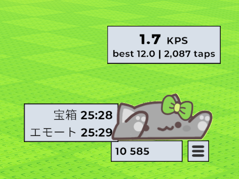
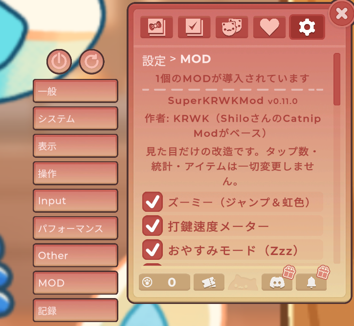

# SuperKRWKMod

**English** | [日本語](README.ja.md)


> Visual-only mod for [Bongo Cat](#bongo-cat-game-): zoomies, cursor-following eyes, a sleepy cat, a typing speed meter, combos, chest notices and typing records. Free, safe, and no cheats.

Based on [Bongo Cat Catnip Mod ↗](https://github.com/Shilo/bongo-cat-catnip-mod/) by Shilo.

| Speed meter and chest countdown | Settings → Mods |
|---|---|
|  |  |

## Table of Contents

- [Features](#features)
- [Languages](#languages)
- [Safety](#safety)
- [Installation](#installation)
  - [Verification](#verification)
  - [Uninstallation](#uninstallation)
- [Bongo Cat Game](#bongo-cat-game-)
- [Developer Setup ↗](docs/DEVELOPER.md)
- [License ↗](LICENSE.md)

## Features

All features are visual only. The mod listens to taps but never changes the game's counters, Steam stats, items or drops. Everything can be switched on or off in game under **Settings → Mods**.

- **Zoomies:** type faster than `BounceKps` keys per second and the cat hops and wobbles; past `RainbowKps` it shimmers in rainbow colours.
- **Speed meter:** current keys per second (KPS), session best and session taps above the cat. Toggle with `F7`.
- **Lively eyes:** the pupils look toward your mouse, the cat blinks now and then, and shows happy "^ ^" eyes when patted (by you or a friend) and at every 100 combo. Eyes are detected automatically, so skins work too.
- **Sleep mode:** after `IdleSeconds` without input the cat breathes slowly, closes its eyes and floats a "Zzz". Any key wakes it. Late at night (23:00–5:00 by default) it dozes off after `NightIdleSeconds` instead.
- **Combo counter:** "×128 COMBO" pops up next to the cat while you keep typing without a pause, changing colour at 50 / 100 / 200.
- **Chest notice:** a speech bubble from the cat ("Chest ready!", only while a chest is out) and a shake of the shop button when you have enough taps for a chest, with a reminder every `ReminderMinutes`. A small countdown next to the combo shows when the next chest appears, or how many taps are still missing. You still open chests yourself: the mod only reads the game's state and never buys or opens anything.
- **Records:** today's taps, typing time, best KPS and longest combo, all-time bests and a bar chart of the last 7 days, on their own **Settings → Records** page. Saved in `SuperKRWKMod\records.csv` and counted by the mod only.
- **Break reminder:** after typing for `Minutes` (50 by default) without a real pause, the cat suggests a little rest. Only a reminder: taps keep counting.
- **Greetings:** the cat says good morning / hello / good evening when the game starts, and once a night suggests bed when it gets late.
- **Adjust numbers in game:** the Mods page has "− value +" rows for the zoomies and rainbow speeds, sleep times, combo start, chest reminder and break reminder.
- **App rules:** switch features off while a given app is running, and back on when it closes (for example, no rainbow glow while playing a rhythm game). In game: **Settings → Mods → App rules → "+ Add from running apps"**, then tick the features to switch off. Only app names are checked, locally.
- **Readable, movable text:** the meter and countdown sit in a box like the game's counter; other text has an outline. Text size, outline colour and thickness are set on the Mods page, and **"Move the text (drag)"** lets you drag each piece of text anywhere.
- **Settings file:** `SuperKRWKMod\superkrwk.ini` in the game folder is created on first launch. Edit it and press `F9` (with Bongo Cat focused) to reload.

Hotkeys only work while the Bongo Cat window has focus (click the cat first).

## Languages

The mod's text follows the game's language setting. Supported: English, Japanese, Chinese (Simplified / Traditional), Korean, Spanish, French, German, Portuguese, Russian, Italian, Polish, Turkish, Ukrainian, Dutch, Czech, Danish, Finnish, Greek, Hungarian, Norwegian, Romanian and Swedish. Hebrew uses English for now.

To force a language, set `Language=` under `[General]` in `superkrwk.ini` (e.g. `Language=en`; `auto` follows the game). Translation fixes are welcome: see [`Translations.cs`](SuperKRWKMod/ModList/Translations.cs).

## Safety

- **No network access.** The mod never connects to the internet.
- **Visual only.** It never changes taps, Steam stats, items or drops, and never buys or opens chests. In multiplayer, other players see your normal cat; the mod sends nothing.
- **Local files only.** It writes only inside the game folder (`SuperKRWKMod\superkrwk.ini` and `records.csv`).
- **App rules** read the names of running apps on your PC to switch features; names are not stored anywhere except the rules you add, and never leave your PC.
- **Open source.** All code is in this repository. The bundled `winhttp.dll` is the official [UnityDoorstop v4.4.1](https://github.com/NeighTools/UnityDoorstop/releases/tag/v4.4.1) loader (Windows x64 verbose build, SHA-256 `1018c7eb5f03ee359d1479d3648b16224794119c43092673fef2ff85dd3eb46d`).
- Some antivirus software may warn about `winhttp.dll`, because loading a mod into a game this way looks similar to other DLL injection. The file is the unmodified official one above.

## Installation

1. Go to the [Releases ↗](https://github.com/kaikomziu/SuperKRWKMod/releases) page
2. Download the latest `SuperKRWKMod.zip` file (or build it yourself with `build.bat`, see [Developer Setup ↗](docs/DEVELOPER.md))
3. Extract the contents of the zip file

**Automatic Installation (Recommended)**

- Double-click `install.bat` in the extracted folder
- The installer will automatically detect your Bongo Cat installation path
- If Bongo Cat is running, it will be automatically closed to ensure a clean installation
- Only mod files (`winhttp.dll`, `doorstop_config.ini`, and `SuperKRWKMod\` folder) will be copied to the game directory
- The game directory will open in Windows Explorer after successful installation

**Manual Installation**

- Copy all files and folders from the `BongoCat` folder to your Bongo Cat installation directory:
  - **Default location:** `C:\Program Files (x86)\Steam\steamapps\common\BongoCat\`
  - The files to copy include:
    - `winhttp.dll` (in the root)
    - `doorstop_config.ini` (in the root)
    - `SuperKRWKMod\` folder (containing `SuperKRWKMod.dll` and assets)

Your game directory structure should look like this:
```
BongoCat/
├── BongoCat.exe
├── winhttp.dll          ← Mod file
├── doorstop_config.ini  ← Mod file
├── SuperKRWKMod/        ← Mod folder
│   ├── SuperKRWKMod.dll
│   └── ... (mod assets)
└── ... (other game files)
```

4. Launch Bongo Cat through Steam as normal

### Verification

Open `%USERPROFILE%\AppData\LocalLow\Irox Games\BongoCat\Player.log` after launching. It should contain `[SuperKRWKMod] SuperKRWKMod | Features ready`. In game, **Settings** should have **Mods** and **Records** categories.

### Uninstallation

**Automatic Uninstallation**

- Double-click `uninstall.bat` in the extracted mod folder
- The uninstaller will automatically detect your Bongo Cat installation path
- If Bongo Cat is running, it will be automatically closed to ensure a clean uninstallation
- Only mod files (`winhttp.dll`, `doorstop_config.ini`, and `SuperKRWKMod\` folder) will be deleted from the game directory
- The game directory will open in Windows Explorer after successful uninstallation

**Manual Uninstallation**

- Delete the mod files from your Bongo Cat installation directory:
  - **Default location:** `C:\Program Files (x86)\Steam\steamapps\common\BongoCat\`
  - The files to delete include:
    - `winhttp.dll` (in the root)
    - `doorstop_config.ini` (in the root)
    - `SuperKRWKMod\` folder (containing `SuperKRWKMod.dll` and assets)

## [Bongo Cat Game →](https://store.steampowered.com/app/3419430/Bongo_Cat/)

[](https://store.steampowered.com/app/3419430/Bongo_Cat/)

> Bongo cat needs your help. Bongo cat needz more hatz!!! Every time you press a key, Bongo cat will punch your taskbar. Type, click, play, work to collect more points. Which hats will you find?

**Publisher:** [Irox Games ↗](https://store.steampowered.com/publisher/irox?snr=1_5_9__2000)  
**Developer:** [Marcel Zurawka ↗](https://store.steampowered.com/developer/irox?snr=1_5_9__2000), [Julius Krüger ↗](https://store.steampowered.com/developer/irox?snr=1_5_9__2000)

*Bongo Cat © Irox Games, Marcel Zurawka, Julius Krüger. Bongo Cat is a trademark of its respective owners. This mod is not affiliated with, endorsed by, or sponsored by the creators of Bongo Cat.*
